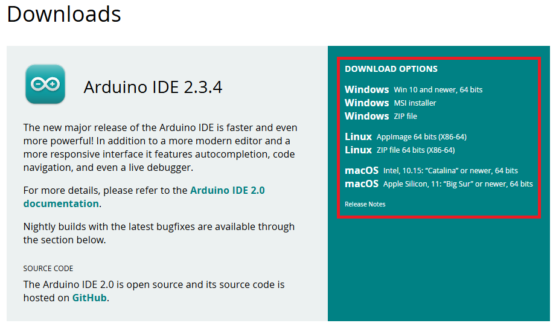
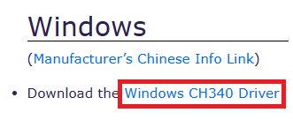
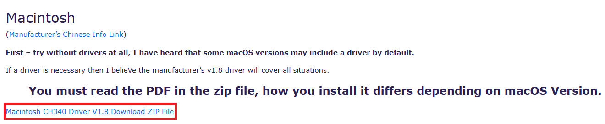
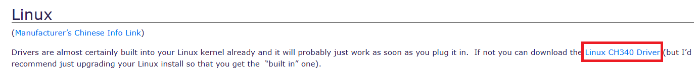
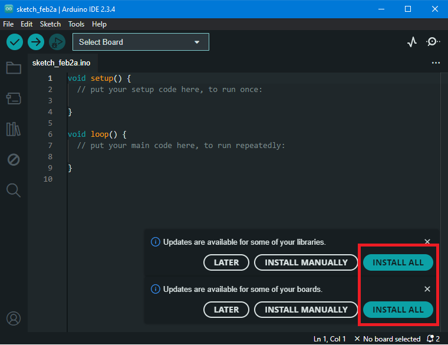
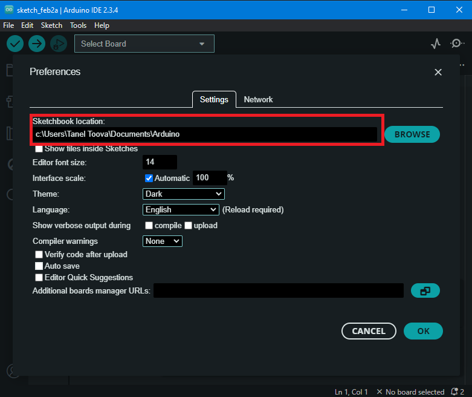
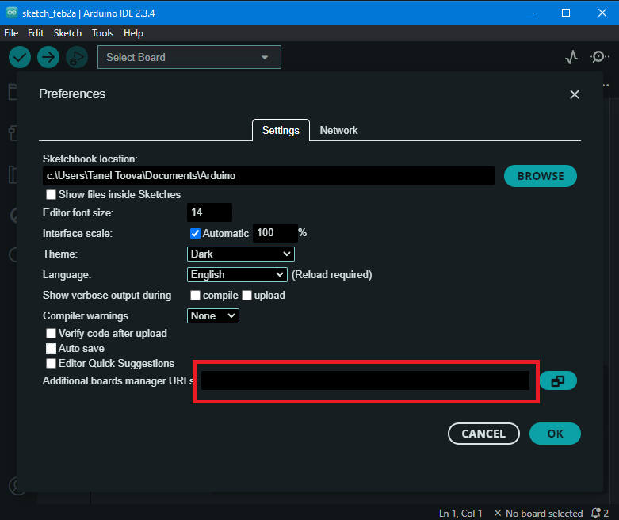

# Arduino IDE paigaldamine

Arduino IDE (Integrated Development Environment) on tarkvaraplatvorm, mida kasutatakse Arduino mikrokontrollerite programmeerimiseks. See pakub kasutajasõbralikku keskkonda, kus saab kirjutada, redigeerida ja üles laadida koodi otse Arduino arendusplaadile. Programmeerimiskeel põhineb C++-il ning IDE sisaldab suurt hulka valmisfunktsioone ja -teeke, mis lihtsustavad riistvaraga suhtlemist.

1. Lae alla Arduino IDE viimane stabiilne versioon oma operatsioonisüsteemi jaoks: [link allalaadimislehele](https://www.arduino.cc/en/software).

    

2. Paigalda allalaetud tarkvara.

    Arduino UNO R3 jaoks paigalda Arduino IDE Boards Manageri kaudu plaadipakett **Arduino AVR Boards**. Arduino UNO R4 WiFi jaoks paigalda **Arduino UNO R4 Boards**.

    Ametlikud UNO R3 ja UNO R4 WiFi plaadid ei vaja CH340-draiverit. CH340- või CH341-draiverit võib vaja minna mõne kolmanda tootja UNO R3-ga ühilduva plaadi korral, kui arvuti plaati pärast ühendamist ei tuvasta: [link allalaadimislehele](https://sparks.gogo.co.nz/ch340.html).

    
    
    

3. Kui CH340- või CH341-draiveri paigaldamine oli vajalik, järgi allalaadimislehel olevaid juhiseid.
4. Ava Arduino IDE. Kui tarkvara pakub plaadipakettide või teekide uuendusi, paigalda need.

    

5. Määra kataloog, kuhu hakatakse vaikimisi salvestama sinu Arduino programme ehk visandeid (ingl *sketch*). Selleks ava menüü "File -> Preferences" ja täida väli "Sketchbook location:".

    

6. Kui kasutad arendusplaadina mõnd _Arduino compatible_ arendusplaati (näiteks Adafruit Flora või NodeMCU), siis pead seadistama selle seadistuslingi. Selleks täida "Additional boards managers URLs" väli.

    
