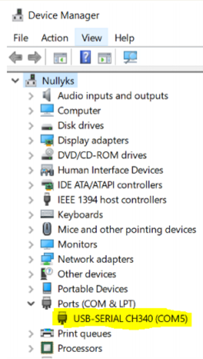
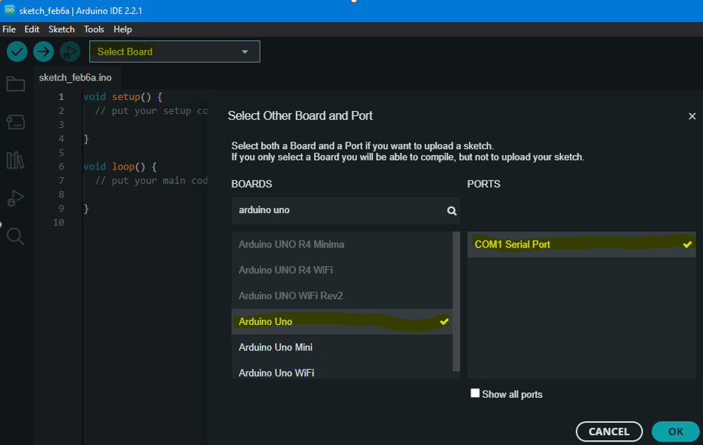
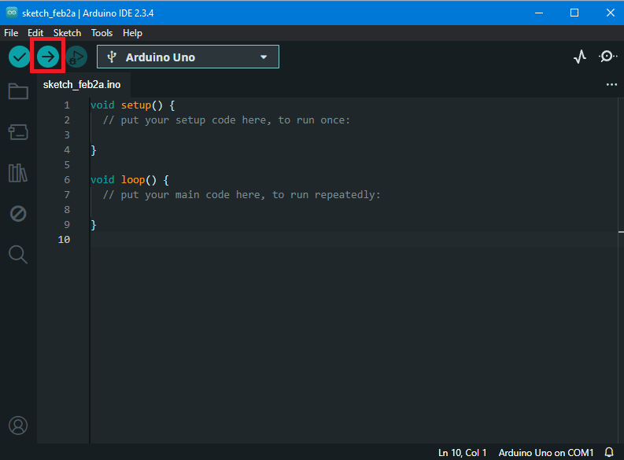

# Arduino arendusplaadi ühendamine arvutiga ja programmi üleslaadimine
Selleks, et meie Arduino arendusplaat midagi huvitavat ja kasulikku teeks, peame kirjutama programmi ja laadima selle arendusplaadile. Programmi kirjutame eelnevalt seadistatud Arduino IDE abil ning sama tarkvaraga laadime selle ka arendusplaadile. Et see saaks toimuda, on vaja Arduino arendusplaat arvutiga ühendada ja Arduino IDE sellega õigesti suhtlema seadistada.

1. Ühenda arendusplaat arvutiga sobiva USB-andmesidekaabli abil. Ametlik UNO R3 kasutab USB-B-pistikut ja UNO R4 WiFi USB-C-pistikut. Kolmanda tootja UNO R3-ga ühilduva plaadi pistik võib erineda. Ainult laadimiseks mõeldud USB-kaabel ei sobi programmi üleslaadimiseks.

2. Tee kindlaks, kas arendusplaat tunti ära ning millise pordi kaudu on see kättesaadav.
    * **Windowsi** operatsioonisüsteemis ava Device Manager (paremklõps menüül Start -> Device Manager) ja otsi jaotise Ports alt Arduino- või CH340-nimelist seadet. CH340 tähistab tavaliselt kolmanda tootja UNO R3-ga ühilduvat plaati. Jäta meelde COM-pordi number.

        

    * **Linuxi** operatsioonisüsteemides on seadme nimeks kas "/dev/ttyACM*" või "/dev/ttyUSB*", kus * tähistab seadme järjekorranumbrit, mis algab numbrist 0. Kõigi selliste seadmete loetelu saab leida, andes terminalis käsuks:
    
            ls /dev/tty*

    * **macOS-i** operatsioonisüsteemides on seadme nimeks kas "/dev/cu.usbmodem*" või "/dev/cu.usbserial-*", kus * tähistab pikemat numbrit. Kõigi selliste seadmete loetelu saab leida, andes terminalis käsuks:
        
            ls /dev/cu.usb*

3. Arduino IDE aknas vali "Select Board" ning määra oma arendusplaadi mudel ja selle ühendusport:

    * UNO R3 korral **Arduino Uno**
    * UNO R4 WiFi korral **Arduino UNO R4 WiFi**

    Kui vajalik plaadipakett puudub, pakub Arduino IDE selle paigaldamist.

    

4. Ühenduse testimiseks laeme arendusplaadile tühja programmi, vajutades ikooni "Upload". Kui avanenud paneelil Output ühtegi veateadet ei ole, siis üleslaadimine õnnestus.

    

## Lisamaterjalid

[Kui programmi üleslaadimine ei õnnestu](https://support.arduino.cc/hc/en-us/articles/4403365313810-If-your-sketch-doesn-t-upload) - Arduino ametlik tõrkeotsingu juhend aitab kontrollida valitud plaati ja porti, USB-ühendust, hõivatud jadaporti ning veateateid.
