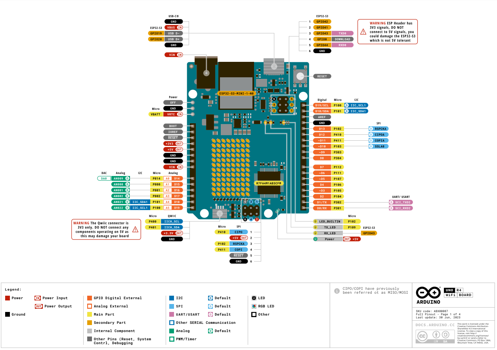

# Arduino UNO R3 ja UNO R4 WiFi arendusplaatide viigud

Selleks, et Arduino arendusplaat saaks ümbritsevast keskkonnast informatsiooni koguda ja seda keskkonda kuidagi mõjutada, tuleb sellega ühendada andurid ja aktuaatorid. Need sisend- ja väljundseadmed suhtlevad arendusplaadiga viikude kaudu. Arduino arendusplaatidel on palju erineva otstarbega ühendusviike ja see võib esialgu tunduda segadust tekitav. Alustamiseks piisab aga vaid mõnede viikude otstarbe tundmisest.

UNO R3 ja UNO R4 WiFi olulisemate viikude paigutus ning 5 V loogikatase on samad. Alloleval joonisel on UNO R4 WiFi viigud. Õppematerjali ühendusskeemid on koostatud UNO R3 jaoks, kuid kirjeldatud erinevusi arvestades töötavad need ka UNO R4 WiFi plaadiga.

*(Allikas: https://docs.arduino.cc/resources/pinouts/ABX00087-full-pinout.pdf)*

**NB!** Kui joonis on GitHubi keskkonnas raskesti loetav, siis laadi alla selle allikas.

Olulisemad viigud on:

* **Toiteviigud** +3.3V, +5V ja GND - Arduino UNO suudab pakkuda püsivat 3.3 V või 5 V pinget. GND on vooluahela ühine 0 V võrdluspunkt ja kõik GND-viigud on samaväärsed. Toiteviike ei saa mõjutada oma programmiga. Toiteviikudest saadaolev vool sõltub arendusplaadist ja kasutatavast toiteallikast.

  **NB!** Toiteviigu koormuspiiri ei tohi segi ajada digitaalse I/O-viigu voolupiiriga. UNO R3 puhul on suurim soovituslik vool ühe I/O-viigu kaudu 20 mA, UNO R4 WiFi puhul 8 mA. Seetõttu kasutatakse selle kursuse LED-i ühendustes 470 Ω takistit, mis sobib mõlema plaadiga.

* **Analoogviigud** A0 kuni A5 - need on sisendviigud andmete lugemiseks. Analoogviigud on ühendatud analoog-digitaalmuunduriga (ADC), mis teisendab viigule rakendatud pinge täisarvuks. Analoogviigud suudavad lugeda pinget vahemikus 0-5 V. Nii UNO R3 kui ka UNO R4 WiFi tagastavad funktsiooni analogRead() kasutamisel vaikimisi 10-bitise väärtuse vahemikus 0-1023. Seetõttu töötab järgnev näitekood mõlemal plaadil muutmata. UNO R4 WiFi võimaldab kasutada kuni 14-bitist ADC-resolutsiooni. Selle kasutamiseks tuleb programmis eraldi kutsuda funktsioon analogReadResolution(14), mille järel on väärtuste vahemik 0-16383. UNO R3 seda võimalust ei toeta. Näiteks viigu A0 väärtuse saame muutuja "andmed" sisse lugeda järgmiselt:
    ~~~cpp
    void setup(){
    }
    void loop(){
        int andmed = analogRead(A0);
    }
    ~~~
   UNO R4 WiFi 14-bitise ADC-resolutsiooni kasutamiseks saab sama näite kirjutada järgmiselt:
    ~~~cpp
    // Ainult UNO R4 WiFi: kasutame 14-bitist ADC-resolutsiooni
    void setup(){
        analogReadResolution(14);
    }
    void loop(){
        int andmed = analogRead(A0); // väärtus 0-16383
    }
    ~~~
   **NB!** Analoogviike on võimalik kasutada digitaalviikudena.

* **Digitaalviigud** 0 kuni 13 - neid viike saab kasutada nii väljund- kui sisendviikudena. Viigu kasutusrežiim tuleb deklareerida setup() funktsiooni sees. Digitaalviikudel on kaks loogikaolekut: LOW ja HIGH. UNO R3 ja UNO R4 WiFi puhul vastab LOW pingele ligikaudu 0 V ning HIGH pingele ligikaudu 5 V. Tegelik väljundpinge võib sõltuvalt viigu koormusest veidi erineda. Kui digitaalviiku kasutatakse sisendviiguna, siis saab selle väärtust lugeda funktsiooniga digitalRead(), mis tagastab LOW või HIGH. Näiteks viigu 2 väärtuse saame muutuja "andmed" sisse lugeda järgmiselt:
    ~~~cpp
    void setup(){
        pinMode(2, INPUT);
    }
    void loop(){
        int andmed = digitalRead(2);
    }
    ~~~
    Kui digitaalviiku kasutatakse väljundviiguna, siis saab selle loogikaolekut määrata funktsiooniga digitalWrite(). Näiteks seame viigu 2 kõrgesse loogikaolekusse HIGH:

    ~~~cpp
    void setup(){
        pinMode(2, OUTPUT);
    }
    void loop(){
        digitalWrite(2, HIGH);
    }
    ~~~
    **NB!** UNO R3 puhul kasutab jadapordiühendus viike 0 (RX) ja 1 (TX), mistõttu võivad nende viikude külge ühendatud seadmed häirida programmi üleslaadimist ja Serial Monitori kasutamist. UNO R4 WiFi puhul on viigud 0 ja 1 seotud eraldi Serial1-liidesega ning arvutiga suhtlemiseks kasutatav Serial liigub sisemise USB-silla kaudu. Et ühendusskeemid töötaksid muutmata mõlemal plaadil, ei kasutata selles materjalis viike 0 ja 1.

* **Pikkusmodulatsiooni (PWM) võimekusega digitaalviigud** 3, 5, 6, 9, 10, 11 - need viigud võimaldavad juhtida täiturite tööd (LED-i eredus, mootori kiirus jms.), lülitades signaali kiiresti olekute HIGH ja LOW vahel ning muutes sellega "sisselülitatud" aja (impulsi pikkuse) ja "väljalülitatud" aja suhet. Seda suhet nimetatakse täiteteguriks (ingl *duty cycle*) ja väljendatakse protsentides. Näiteks LED-i puhul tähendab suurem täitetegur üldjuhul eredamat valgust ja väiksem täitetegur tuhmimat valgust. PWM-võimekusega viigu täitetegurit saame määrata funktsiooniga analogWrite(). Loetletud PWM-viigud ja funktsiooni analogWrite() vaikimisi väärtusvahemik 0-255 on UNO R3 ja UNO R4 WiFi puhul samad. Näiteks määrame viigule 3 täiteteguri 50%:
    ~~~cpp
    void setup(){
        pinMode(3, OUTPUT);
    }
    void loop(){
        analogWrite(3, 127);
    }
    ~~~

## Lisamaterjalid
[Arduino programmi põhistruktuur](https://docs.arduino.cc/learn/programming/sketches/) - Arduino programm ehk visand sisaldab funktsioone `setup()` ja `loop()`. Funktsioon `setup()` käivitatakse programmi alguses ühe korra ning `loop()` kordub seni, kuni arendusplaat töötab.

[Arduino keele käsiraamat](https://docs.arduino.cc/language-reference/) - Arduino ametlikust käsiraamatust leiab funktsioonide, muutujate, konstantide ja programmi struktuurielementide kirjeldused ning kasutusnäited.

[Arduino UNO R4 WiFi andmeleht](https://docs.arduino.cc/resources/datasheets/ABX00087-datasheet.pdf) - UNO R4 WiFi on 32-bitise mikrokontrolleriga 5 V arendusplaat, mille I/O-viigu soovituslik voolupiir on 8 mA.

[Arduino UNO R3 andmeleht](https://docs.arduino.cc/resources/datasheets/A000066-datasheet.pdf) - UNO R3 on 8-bitise mikrokontrolleriga 5 V arendusplaat, mille jaoks on koostatud selle õppematerjali ühendusskeemid ja Tinkercadi näited.

[Arduino UNO R3 täielik viigustik](https://docs.arduino.cc/resources/pinouts/A000066-full-pinout.pdf) - ametlik joonis näitab UNO R3 viikude paigutust, PWM-võimekust, sideliideseid, toiteviike ja I/O-viigu 20 mA voolupiiri.

[Arduino UNO R3 ja UNO R4 võrdlus](https://support.arduino.cc/hc/en-us/articles/9350551575964-What-s-the-difference-between-UNO-R3-and-UNO-R4-boards) - ülevaade plaatide peamistest tehnilistest erinevustest.
