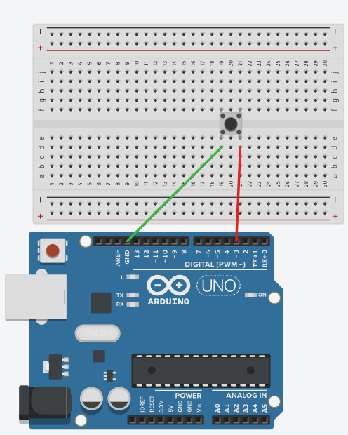
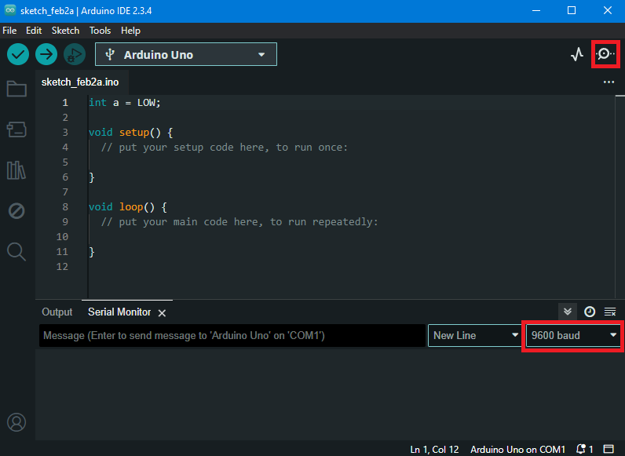

# Nupuvajutuse lugemine Arduino UNO arendusplaadiga

Seame endale eesmärgiks lugeda kokku, mitu korda on kasutaja vajutanud Arduino UNO arendusplaadiga ühendatud nuppu, ning kuvada tulemus jadapordiühenduse kaudu arendusplaadiga ühendatud arvutis tekstina. **NB!** Arduino IDE oskab jadapordi kaudu andmeid vahetada.

Selle ülesande saab jagada alamülesanneteks, milleks on:

1. nupu ühendamine Arduino UNO-ga
2. nupuvajutuse sündmuse tuvastamine
3. nupuvajutuse kordade kokku lugemine
4. tulemuse edastamine üle jadapordiliidese

[Vaata lahendust Tinkercadi keskkonnas](https://www.tinkercad.com/things/dHP2XfOs5vp-nupu-naide?sharecode=jzB2TWMdpPlzkOqoctD38mrp9T9ty2W0vcmSFo8u6xI)

Tinkercadi näide kasutab Arduino UNO R3 plaati. Näites kasutatav viik 3, INPUT_PULLUP-režiim, ühenduspõhimõte ja programmikood kehtivad ka Arduino UNO R4 WiFi puhul.

**NB!** Koosta või muuda vooluahelat siis, kui arendusplaat on USB-kaablist lahutatud. Enne toite ühendamist kontrolli, et 5 V ja GND poleks omavahel otse ühendatud. LED-i ühendamisel kasuta alati voolupiiravat takistit.

## Nupu ühendamine
Nupul on kaks poolt, mis ei ole omavahel ühendatud, kui nuppu ei vajutata. Kui nuppu vajutatakse, siis sel ajal on pooled ühendatud ja nende vahel saab liikuda elektrivool.
Kasutame ära Arduino UNO võimekust määrata digitaalse viigu (valime viigu 3) režiimiks INPUT_PULLUP. See tähendab, et viik ei ole mitte ainult sisend (mille väärtust me loeme), vaid et vaikimisi olekus on sellele langev pinge ligikaudu 5 V (ühendatud Arduino siseselt läbi takisti).
Ühendame viigu 3 nupu ühe poolega ja nupu teise poole ühendame GND-viiguga. Kui nuppu vajutatakse, siis ühendab see viigud 3 ja GND (0 V). Selle tulemusena muutub viigule 3 langev pinge ligikaudu 0 V-ni.

## Nupuvajutuse tuvastamine
Kui me loeme viigu 3 väärtust funktsiooniga digitalRead() sel ajal, kui nuppu ei ole vajutatud, saame tulemuseks HIGH (ligikaudu 5 V). Aga kui loeme sel ajal, kui nuppu vajutatakse, saame tulemuseks LOW (ligikaudu 0 V).
Seega, kui me loeme piisavalt sageli viigu 3 väärtust, saame tuvastada, kas see on LOW. Arduino programmi kohustuslik funktsioon loop() täidab kõiki selles olevaid käske n-ö ringiratast: kui loop() jõuab lõppu, algab see lihtsalt otsast peale.

Kui kirjutame viigu 3 lugemise `loop()` funktsiooni sisse, kontrollib Arduino nupu olekut väga sageli ja lühike nupuvajutus tuvastatakse tavaliselt probleemideta. Täpne kontrollimiste arv sekundis sõltub arendusplaadist ja ülejäänud programmist.

See lähenemine ei pruugi töötada, kui `loop()` funktsioon sisaldab pikki `delay()` käske või muid blokeerivaid tegevusi, mille täitmise ajal nupu olekut ei kontrollita. Loeme viigu 3 väärtuse ja kontrollime, kas see on `LOW`:
~~~cpp
    void setup(){
        pinMode(3, INPUT_PULLUP);
    }
    void loop(){
        int nupuOlek = digitalRead(3);
        if(nupuOlek==LOW){
           //nuppu vajutati 
        }
    }
~~~
## Nupuvajutuste kokkulugemine
Nüüd on meie edasiseks ülesandeks lugeda kokku nupuvajutuste arv. Selleks võtame kasutusele globaalse täisarvulise muutuja "vajutusi", mis toimib loendurina. Iga kord, kui tuvastatakse nupuvajutuse sündmus, suurendatakse selle muutuja väärtust ühe võrra.

Kuna Arduino täidab loop() funktsiooni väga kiiresti, võib sama nupuvajutuse ajal jõuda viigu väärtust lugeda mitu korda. Selle vältimiseks peatame programmi pärast vajutuse registreerimist 200 millisekundiks käsuga delay(200). Selle aja jooksul jõuab kasutaja tavaliselt nupu vabastada ja järgmisel lugemisel on viigu väärtus jälle HIGH.

See on lihtne lahendus, mis sobib lühikeste nupuvajutuste lugemiseks. Kui nuppu hoida all kauem kui 200 millisekundit, võib programm lugeda seda mitu korda. Täpsemates programmides saab vajutuse tuvastada nupu oleku muutumise järgi, kuid selles näites me seda veel ei käsitle. Meie programm on nüüd selline:
~~~cpp
    int vajutusi=0; // deklareerime muutuja ja väärtustame nulliga

    void setup(){
        pinMode(3, INPUT_PULLUP);
    }
    void loop(){
        int nupuOlek = digitalRead(3);
        if(nupuOlek==LOW){
           vajutusi=vajutusi+1; // tõstame loenduri väärtust 1 võrra
           delay(200); // ootame 200 ms, et kasutaja jõuaks nupu vabastada
        }
    }
~~~

## Tulemuse edastamine üle jadapordiliidese
Kuna me tahame kasutajale teada anda, mitu korda ta nuppu vajutanud on, siis saame kasutada võimalust saata need andmed Arduinoga ühendatud arvutisse jadapordi kaudu. **NB!** See töötab ainult siis, kui Arduino ja arvuti on USB-kaabliga ühendatud.

Jadapordiühenduse kasutamiseks peame deklareerima setup() funktsiooni sees ühenduse alustamise koos ühenduskiirusega. Selleks on olemas funktsioon Serial.begin(). Kui jadapordiühendus on alustatud, siis on võimalik saata andmeid, kasutades funktsioone Serial.print() ja Serial.println() - neist esimene saadab andmed ilma realõpusümbolita ja teine koos sellega. Meie kood näeb nüüd välja selline:
~~~cpp
    int vajutusi=0; // deklareerime muutuja ja väärtustame nulliga

    void setup(){
        pinMode(3, INPUT_PULLUP);
        Serial.begin(9600); //alustame jadapordiühendust
    }
    void loop(){
        int nupuOlek = digitalRead(3);
        if(nupuOlek==LOW){
           vajutusi=vajutusi+1; // tõstame loenduri väärtust 1 võrra
           delay(200); // ootame 200 ms, et kasutaja jõuaks nupu vabastada
           Serial.print("Nupuvajutusi on: "); //tekst ilma realõputa
           Serial.println(vajutusi); //muutuja väärtus + realõpp
        }
    }
~~~

Arduino IDE oskab arvutis jadapordiühendust jälgida. Vastav paneel avaneb, kui vajutada ikooni "Serial Monitor". Oluline on, et nii lugev kui ka saatev seade kasutaksid sama ühenduskiirust (ingl *baud rate*).

## Lisamaterjalid
[Makettplaadi kasutamise juhend](https://learn.sparkfun.com/tutorials/how-to-use-a-breadboard/all) - juhend selgitab, millised makettplaadi augud on omavahel elektriliselt ühendatud ning kuidas kasutada toiterööpaid. Sellest on abi nupu ja LED-i ühendusjooniste füüsilisel kokkupanemisel.

[Nupp pull-down-takistiga ja olekumuutujaga](https://docs.arduino.cc/built-in-examples/digital/Button/) - meie näites lugesime nupuvajutuse siis, kui viigu olek muutus HIGH -> LOW, kuid seda saab teha ka vastupidi. Samuti kasutatakse selles näites nupu oleku määramiseks muutujat, mis mõnikord on ka kasulik lahendus.

[Arduino IDE 2 Serial Monitori kasutamine](https://docs.arduino.cc/software/ide-v2/tutorials/ide-v2-serial-monitor) - Arduino ametlik juhend selgitab Serial Monitori avamist, ühenduskiiruse valimist ning andmete saatmist ja vastuvõtmist.

[Jadapordiühenduse selgitus koos kõigi funktsioonidega](https://docs.arduino.cc/language-reference/en/functions/communication/serial/) - meie näites kasutasime jadapordiühendust väga lihtsal viisil. Tegelikult on sellega võimalik palju rohkem teha. Siin on asjakohane dokumentatsioon iseseisvalt edasi uurimiseks.
