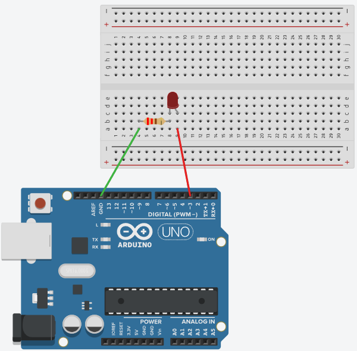

# LED-i juhtimine

Seame endale eesmärgiks vilgutada LED-i kõigepealt 5 korda sisse ja välja ning seejärel juhtida LED-i pikkusmodulatsiooni abil 33%, 66% ja 100% täiteteguriga.

Selle ülesande saab jagada alamülesanneteks, milleks on:
* LED-i ühendamine Arduino UNO-ga
* LED-i vilgutamine lülitades seda sisse ja välja
* LED-i heleduse juhtimine pikkusmodulatsiooni (PWM) abil

[Vaata lahendust Tinkercadi keskkonnas](https://www.tinkercad.com/things/aUQMRRQp4VC-led-i-naide?sharecode=A0VPoYtYasrdUSRN4kEtaZbjpWbUwGX7AnCLGtIL6Ms)

Tinkercadi näide ja ühendusjoonis kasutavad Arduino UNO R3 plaati ning 220 Ω takistit. Viik 3, PWM-i ühenduspõhimõte ja programmikood kehtivad ka Arduino UNO R4 WiFi puhul. Füüsilises vooluahelas kasutame 470 Ω takistit, mis sobib mõlema plaadiga.

## LED-i ühendamine
LED on diood, mis kiirgab valgust, kui seda läbib elektrivool. Kuna tegemist on dioodiga, siis läbib elektrivool seda vaid ühes suunas - anoodilt katoodile. Tavalise 5 mm LED-i puhul on anoodiks pikem elektrood ja katoodiks lühem elektrood.

Kui dioodi läbib piisava pingega vool, siis muutub dioodi enda sisemine takistus väga väikeseks. Seetõttu on tarvis dioodiga jadamisi ühendada püsitakisti, mis piirab vooluahelas voolutugevust, et see dioodi läbi ei põletaks. UNO R3 puhul on 220 Ω takisti tavapärane, kuid UNO R4 WiFi ühe I/O-viigu voolupiir on 8 mA. Punase LED-i korral võib 220 Ω takistiga vool olla ligikaudu 13 mA. Seetõttu kasutame kursuse füüsilistes vooluahelates 470 Ω takistit, mis hoiab voolu alla 8 mA ja sobib ka UNO R3 plaadiga.

Kuna meie eesmärk on LED-i juhtida, siis peame vooluallikaks valima sellise viigu, mida saame oma programmis mõjutada. Selleks sobib väga hästi digitaalviik 3, mis on muu hulgas ka PWM-võimekusega. Et vooluahel töötaks, tuleb selle teine ots ühendada GND-viiguga.

## LED-i vilgutamine
Kuna oleme vooluallikaks valinud viigu 3, siis tuleb see deklareerida väljundviiguna - OUTPUT. Selleks kasutame funktsiooni pinMode(). 

Kuna me tahame oma LED-iga teha erinevaid asju (vilgutada ja muuta heledust), siis deklareerime iga tegevuse jaoks oma funktsiooni, mida kutsume eraldi välja. Vilgutamiseks deklareerime funktsiooni vilguta(). Selle funktsiooni sees seame viigu 3 funktsiooniga digitalWrite() vastavalt kõrgesse (HIGH) või madalasse (LOW) loogikaolekusse - lülitame LED-i sisse ja välja.

Selleks, et ka inimene muutust näeks, peab LED mõnda aega olema nii sisselülitatud kui ka väljalülitatud. Kasutame delay() funktsiooni arendusplaadi protsessori ajutiseks blokeerimiseks.

Funktsiooni `vilguta()` parameeter määrab, mitu korda LED vilgub. Kutsume funktsiooni `vilguta(5)` välja `setup()` funktsioonis, mida Arduino täidab pärast käivitamist ainult ühe korra. Seetõttu vilgub LED täpselt viis korda. Seejärel liigub programm edasi `loop()` funktsiooni juurde.

Saame järgneva koodinäite:
~~~cpp
void setup(){
    pinMode(3, OUTPUT); // viik 3 on väljund
    vilguta(5); // vilgutame LED-i 5 korda
}

void loop(){
}

void vilguta(int kordi){
    while(kordi>0){
        digitalWrite(3,HIGH);
        delay(500);
        digitalWrite(3,LOW);
        delay(500);
        kordi=kordi-1;
    }
}
~~~
## LED-i heleduse muutmine
LED-i heledust saame juhtida pikkusmodulatsiooni abil, kasutades analogWrite() funktsiooni. Funktsioonile antav väärtus 0-255 määrab täiteteguri: 0 tähendab, et viik on alati LOW, 255, et viik on alati HIGH, ning vahepealsed väärtused lülitavad viiku kiiresti kahe oleku vahel. Suurem täitetegur muudab LED-i üldjuhul eredamaks, kuid täiteteguri protsent ei kirjelda täpselt inimese tajutavat heledust.

Pärast viit vilgutamist lõpeb `setup()` funktsiooni täitmine ja Arduino alustab `loop()` funktsiooni kordamist. Kutsume selles välja funktsiooni `muudaHeledust()`, mis rakendab LED-ile järjest 33%, 66% ja 100% täiteteguri. Kuna funktsioon asub `loop()`-is, korratakse seda kolmeastmelist jada seni, kuni Arduino töötab. Lisades selle juba olemasolevale koodile saame järgneva tulemuse:

~~~cpp
void setup(){
    pinMode(3, OUTPUT); // viik 3 on väljund
    vilguta(5); // vilgutame LED-i käivitamisel 5 korda
}

void loop(){
    muudaHeledust(); // kordame täitetegurite jada
}

void vilguta(int kordi){
    while(kordi>0){
        digitalWrite(3,HIGH);
        delay(500);
        digitalWrite(3,LOW);
        delay(500);
        kordi=kordi-1;
    }
}

void muudaHeledust(){
    analogWrite(3,85);  // täitetegur umbes 33%
    delay(1000);
    analogWrite(3,169); // täitetegur umbes 66%
    delay(1000);
    analogWrite(3,255); // täitetegur 100%
    delay(1000);
}
~~~

## Lisamaterjalid
[Pikkusmodulatsiooni (PWM) alused](https://docs.arduino.cc/learn/microcontrollers/analog-output/) - Arduino ametlik ülevaade selgitab, kuidas digitaalviigu kiire lülitamine olekute `HIGH` ja `LOW` vahel tekitab erineva täiteteguriga PWM-signaali.

[LED-i vilgutamine ilma delay() funktsioonita](https://docs.arduino.cc/built-in-examples/digital/BlinkWithoutDelay/) - meie näites blokeerisime LED-i vilgutamiseks ajutiselt Arduino töö. Mõnikord on aga tarvis sel ajal hoopis midagi teha, mitte oodata. Lingil on näide, kuidas seda teha.

[Funktsioonide kasutamisest Arduino programmides](https://docs.arduino.cc/learn/programming/functions/) - veidi pikem selgitus oma funktsioonide tegemise kohta.
